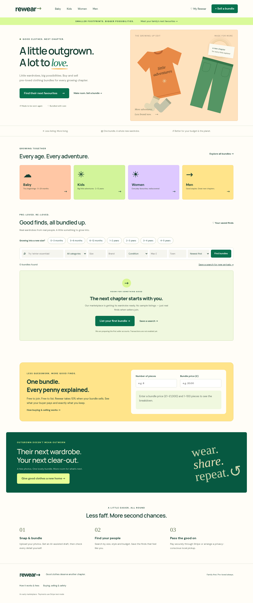

# Rewear

A mobile-first family clothing bundle marketplace built with Next.js App Router, TypeScript, Supabase/PostgreSQL and Stripe Connect. The repository originally contained one blank file; this is the initial implementation, not a completed production launch.



[View the dark-mode preview](docs/website-dark.png)

## Appearance

Use the **Appearance** selector in the header to choose **Light**, **Dark** or **System**. System is the default and follows device changes. The choice is stored locally on that browser/device and persists across visits; no account is required. When storage is blocked, the choice works for the current page but cannot be reliably retained across reloads. The theme is applied before page painting, and shared styles cover discovery, forms, listings, account/administrator panels and messages. Automated contrast scans cover the publicly accessible pages; connected authenticated flows still require the acceptance checks below.

## iPhone preview with Expo Go

A separate Expo project lives in [`mobile/`](mobile/README.md). It displays the hosted website inside a native WebView; it is not a native marketplace rewrite or an App Store release. Website and mobile dependencies stay separate. The mobile README includes exact Windows PowerShell startup commands, version compatibility, website verification status, login limitations and device checks. This branch preserves the separate PWA work in PR #1 without merging it.

## Website launch

See [the exact website-launch steps](docs/website-launch.md). Vercel hosts the Next.js website; Supabase provides accounts, PostgreSQL and photo storage. The `vercel.json` configuration is included. Deployment still requires signing into the account that owns the hosting project.

The latest version adds a vibrant shared palette, a three-step seller workflow, item-by-item bundle contents, transparent price-per-piece/fee calculations, editable active listings, server-side price-per-piece sorting and authenticated payment recovery. Run **both migrations in order** for a new project; apply only the second if the first is already installed. Existing listings keep working, but need item details when edited. New listings must include a count-consistent contents breakdown.

## Run

Node.js 24 is the tested runtime.

```sh
npm ci --cache /workspace/.npm-cache
cp .env.example .env.local
npm run dev
```

The public discovery site runs without credentials, shows an honest empty inventory, and never generates sample products or payments. Account, upload and inventory operations require Supabase. Payment operations require Stripe test credentials. Set environment values before building; rebuild when changing public Supabase variables. Keep `.env.local` out of Git.

```sh
npm test
npm run typecheck
npm run build
npm run start
npm run test:e2e
```

Playwright uses `/usr/bin/chromium` in this cloud environment. Set `PLAYWRIGHT_CHROMIUM_EXECUTABLE_PATH` on another machine or install Playwright Chromium and use its managed browser. The browser suite deliberately tests the unconfigured state; run it without Supabase variables against a separate development instance. It does not validate connected purchasing.

## Connect Supabase

1. Create a dedicated development Supabase project. Apply [the initial migration](supabase/migrations/20261018000000_initial.sql), then [the bundle-details and recovery migration](supabase/migrations/20261018010000_bundle_details_and_recovery.sql), once each and in that order, in its SQL editor. It creates tables, constraints, private photo storage, RLS policies, atomic inventory reservation, throttles and webhook state transitions. The migration expects Supabase's existing `auth` and `storage` schemas; do not apply it to a plain database without those services.
2. Put the project URL, legacy anon JWT key and service role key in the variables listed in `.env.example`. Only the anon key and project URL are public. Never expose the service role key to client code.
3. Set the Auth Site URL to `APP_URL`. Add the exact `${APP_URL}/auth/callback` and password-reset callback URLs to allowed redirects. Enable email confirmation, a minimum 12-character password policy, Auth abuse controls and SMTP. The server refuses unverified email accounts even if the project was configured to skip verification.
4. Enable TOTP in Supabase Auth. Administrators sign in, enroll/verify an authenticator from their account page, then access `/admin`. Membership comes exclusively from the private `admins` table; no signup metadata can grant it. A database owner can grant a real account membership using `insert into public.admins(user_id) values ('REAL_AUTH_USER_UUID');`.
5. Create two real test accounts, verify their emails, publish a clothing bundle with real photos, and exercise buying and selling with separate users. Do not put fixtures in the public marketplace.

Uploads are authenticated and throttled. The server decodes and re-encodes JPEG/PNG/WebP using Sharp, strips metadata, limits pixel count and stores sanitized originals privately. Listing image links expire after 15 minutes. Signed links can be shared until expiry; they are not a substitute for moderation. User withdrawal and administrator removal hide listings, not the payment history.

## Connect Stripe (test mode only)

Set `STRIPE_SECRET_KEY` to an `sk_test_` key and `STRIPE_WEBHOOK_SECRET` to the endpoint's signing secret. Live API keys and live webhook events are refused. Enable Connect Express for GB sellers. Sellers use the account page to complete Stripe onboarding; eligibility follows signed `account.updated` events, not a browser redirect. The Stripe Express dashboard provides actual balances, payout history and payout settings.

Configure the webhook URL at `${APP_URL}/api/stripe/webhook` and subscribe to:

- `account.updated` (connected-account events)
- `checkout.session.completed`
- `checkout.session.async_payment_succeeded`
- `checkout.session.expired`
- `charge.refunded`

For local development, Stripe CLI forwarding can deliver platform and connected-account events. Use the signing secret for that forwarding endpoint. Checkout uses GBP integer pence, a server-calculated 10% application fee and a destination transfer to the seller. Rounding is to the nearest penny. Stripe processing fees are borne by the platform. Seller proceeds shown in order history are before later refunds and adjustments. Payout timing remains under Stripe's control.

The current purchase flow is **local pickup only**, and only for listings that explicitly allow pickup. A reservation locks the bundle against another checkout. Accepted offers change the server-authoritative order amount. Browser success redirects never mark an order paid. The signed webhook verifies amount and currency and applies an idempotent database transition. Buyers confirm receipt; sellers or administrators can request full refunds with reversal of the seller transfer and platform fee. Only full refunds are currently modeled.

A pending order can resume its existing Checkout session. A valid expiry event releases its reservation. Buyers and sellers can use **Check payment status** on a pending order to reconcile it against Stripe. Known sessions must match the order reference, currency and amount. For a sessionless reservation, recovery waits at least 65 minutes, exhaustively checks Stripe's sessions created since the reservation, and releases inventory only when no matching session exists. A failed, truncated or oversized Stripe scan retains the reservation. Database release is server-only and atomic. This recovery flow has automated tests but still needs validation against real Stripe test-mode failure scenarios. Scheduled reconciliation, partial refunds, bank chargeback handling and retryable financial job processing remain release blockers.

## Stages and current scope

| Stage | Implemented | Remaining validation / work |
|---|---|---|
| 1: Inventory and accounts | Email signup/login/recovery, session refresh, profiles/storefronts, real photo uploads, optional AI drafts with mandatory verification, multi-piece listings, category/size/brand/condition/town/price filters, favorites, saved searches and in-app new-listing alerts | Connected Supabase Auth/Storage/PostgREST end-to-end tests, real seller usability and content safety review |
| 2: Transactions | Offer acceptance, atomic reservation, Stripe Connect test onboarding/Checkout, signed/idempotent payment webhooks, full refunds, receipt confirmation, transaction history, Stripe payout dashboard, order messaging, local pickup guidance | Real Stripe test purchase/refund/payout checks, concurrent live-database tests, connected validation of orphan recovery, chargebacks, full shipping purchase flow |
| 3: Operations | Database-authorized AAL2 admin page, listing reports, withdrawal/removal of active listings, disputes, resolution controls, status audit trail, operating metrics and cost entry | Moderation staffing and escalation, suspended accounts, removal of sold/reserved harmful content, formal appeal/evidence workflows, retention/deletion procedures and operational incident drills |

The UI never labels these integrations as successful without their responses. In-app alerts are not email/push notifications. Search personalization is based on explicit saved preferences, not an unimplemented recommendation model. Offers, messages, reports and search creation are also throttled at the database layer so direct API calls cannot bypass the application endpoint's write limit.

## AI and shipping boundaries

Optional `OPENAI_API_KEY` enables actual image-assisted drafts through OpenAI `gpt-4o-mini`. Clicking the draft button sends the selected photos to OpenAI. The model may suggest title and description only; sellers enter brand, size, quantity and condition and must check every detail. The draft is never automatically published. Without an AI credential, manual listing creation remains available.

`lib/shipping.ts` defines a provider interface and an EasyPost adapter for real parcel creation/rating using `EASYPOST_API_KEY`, with validated GB addresses and parcel measurements. **Label purchase, buyer rate selection, shipping-charge calculation, carrier callbacks and tracking reconciliation are not yet implemented.** Shipping checkout is disabled rather than charging an invented amount. Add those capabilities and provider sandbox tests before enabling shipped orders. Do not pass raw address data into public profile or listing fields.

## Measurement

The administrator dashboard reports actual recorded data only. Definitions and limitations are displayed beside the metrics:

- Active sellers: distinct sellers with at least one active bundle.
- Qualified listings: active, seller-verified listings. This is not platform quality certification.
- Buyer conversion: distinct authenticated listing viewers with a receipt-confirmed order / distinct authenticated listing viewers, all time.
- Completed orders: orders with a recorded receipt confirmation, including later refunds.
- Refunds and refund rate: fully refunded orders / all orders recorded paid, including refunded orders.
- Repeat purchase rate: buyers with at least two receipt-confirmed orders / buyers with any receipt-confirmed order.
- CAC: recorded acquisition spend / distinct buyers with receipt-confirmed orders. No data is reported when spend is absent. This is an all-time blended proxy, not cohort or campaign attribution.
- Contribution margin: commissions on non-refunded paid orders minus recorded payment, shipping subsidy, other variable and acquisition costs. It stays unavailable until every paid/refunded order has a cost entry. Tax, fixed costs and unrecorded adjustments are excluded.

Supabase's default API row limits can truncate large operational datasets. Before scale, replace the initial dashboard's bounded client queries with audited SQL aggregates and time-window/cohort definitions. The current figures are suitable for an early test marketplace, not financial reporting.

## Validation and release status

`npm test` runs domain checks, real PostgreSQL semantics using embedded PGlite, and Stripe signature/route tests. PGlite tests bootstrap minimal Supabase schema contracts; they are not a substitute for testing deployed Supabase Auth, Storage or PostgREST. Stripe webhook route tests use signed synthetic fixtures exclusively inside the test runner. They never create marketplace listings or orders in the application.

`npm run test:e2e` checks the public empty state, filters, account gating, admin rejection and viewport fit in desktop and mobile Chromium. Production build and runtime HTTP smoke checks have also been exercised. No actual Supabase account flow, Stripe payment/refund/payout, AI generation, or shipping provider call has been completed in this environment because service credentials are absent.

**Do not describe this marketplace as secure or production-ready.** Complete [the connected acceptance checks](docs/acceptance.md), address the stated release blockers and conduct a security and marketplace-safety review before taking real orders. No production deployment has been performed.
